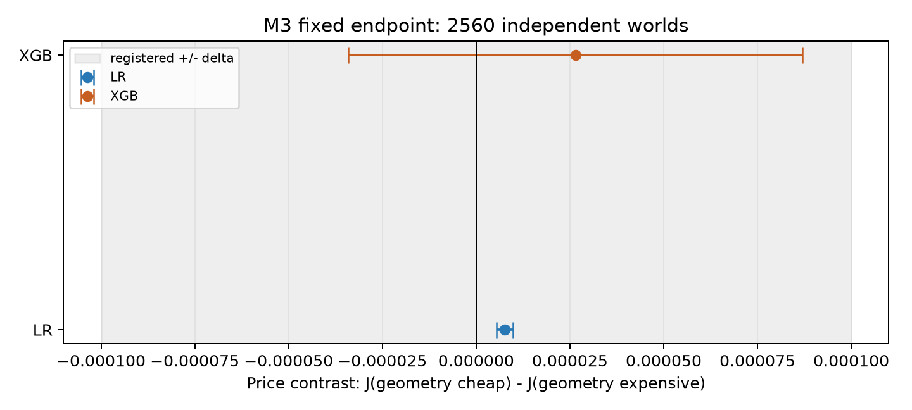
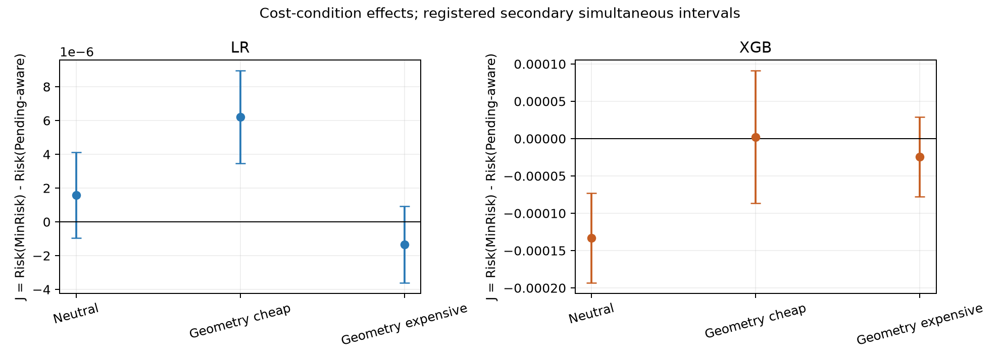
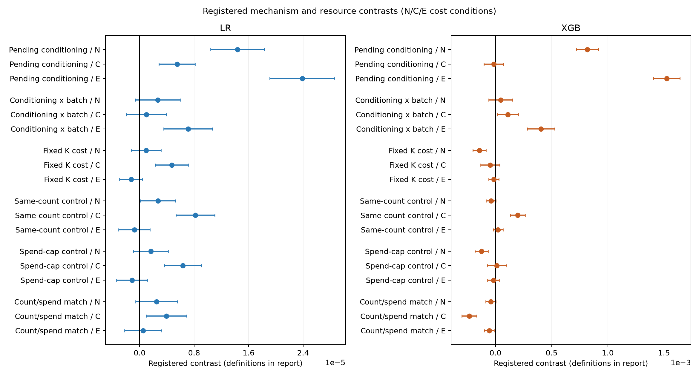

# 普通反馈之外的风险预算探索

本目录综合 M1–M3 的机制研究、冻结协议与可复算证据。研究承接信息价值、目标实验设计、pending 条件化及预算主动学习，检验实际分类风险的条件与成本配对作用。

M3 已完成 **2,560 个独立新世界**、每世界 4 次标签重复的固定终点确认；32 个方差试验世界没有并入。原始记录全量审计和 52 项区间的独立复算通过。

| 学习器 | price 点估计 | 同时区间 | 登记判定 |
|---|---:|---|---|
| LR | +0.000007555 | [+0.000005350, +0.000009760] | 确认正方向，未达到实质正门槛 |
| XGB | +0.000026455 | [-0.000034092, +0.000087001] | 区间落在预定等效带内 |

其中 `J = Risk(MinRisk) - Risk(Pending-aware)`，`price = J_geometry-cheap - J_geometry-expensive`。delta 为 0.0001。主家族 alpha=0.04，次家族 alpha=0.01；均使用独立世界配对 t 近似同时区间。完整结果包括所有正向、反向和未识别项。

## 阅读顺序

1. [M1–M3 综合推断](reports/M1_M3_synthesis.zh.txt)：结论、证据承接和适用范围。
2. [M3 完整报告](reports/M3_cost_pairing.zh.txt)：全部 52 项对比及资源控制。
3. [M1/M2 证据收束](reports/M1_M2_evidence.zh.txt)与[前人工作对照](reports/related_work.zh.txt)。

M3 的[冻结代码](m3/code/study.py)、[确认登记](m3/protocols/confirmation_v1_registration.json)、[完整区间表](m3/summary.csv)及[全量原始记录审计](m3/confirmation_audit.json)可直接浏览。

## 核心图

## 证据包与复核

- [M1/M2 数学连接、证据收束与文献定位](archives/M1_M2_synthesis_20261101.zip)
- [M2 原登记矩阵与完成验收](archives/M2_original_completion_20261031.zip)
- [M2 反转、域边界与条件恢复研究](archives/M2_reversal_20261031.zip)
- [M3 成本配对确认与完整源代码](archives/M3_cost_pairing_20261101.zip)

运行 `python verify_all.py`：校验归档字节并实际解压，分别重算 M1/M2 与 M3 的公开证据。无需 GPU；依赖 NumPy、Pandas、SciPy。加 `--examples` 可在安装 scikit-learn/XGBoost 后重构四个 M3 原始样例，仍无需新训练。

M3 全部逐世界推断数据公开；完整大型原始预测保留本地，公开全量哈希、审计记录和四个按 ID 选定的原始样例。不重新分发第三方原始信用数据或私人规划文档。

## 承接关系与范围

信息的替代与互补采用 [Chen 与 Waggoner](https://arxiv.org/abs/1703.08636) 等工作的语言，目标加权设计承接 [BAIT](https://proceedings.neurips.cc/paper/2021/file/4afe044911ed2c247005912512ace23b-Paper.pdf)，目标风险评价与 [EPIG](https://proceedings.mlr.press/v206/bickfordsmith23a.html)、[损失驱动 BAL](https://proceedings.mlr.press/v300/huang26b.html) 相衔接，等待反馈与[验证延迟研究](https://link.springer.com/article/10.1007/s10994-021-06099-z)有明确联系。本文的重点是具体条件、迁移失效、干预与边界证据。

M3 的 GainBudget-Pending 是使用同一目标代理的预算可行原始边际值比较工具，不声称复现 ConBatch-BAL 或 ParBaLS-EPIG。强近邻公平比较、真实任务、样本外诊断及 M4/M5 仍待后续研究；本目录不宣称总方案全部完成或新 SOTA。

旧归档中的阶段禁止标记保留各自冻结时点；本次 M3 采用新的授权和登记，未覆盖历史源文件。M1/M2 的 K 对比与 M3 的 J/price 是不同对象。

公开版本说明：GitHub 中四个归档为路径脱敏副本；原始冻结字节完整保留本地。公开导出只替换本机目录前缀，不改变数值证据、实验规则或推断。历史登记中的源文件哈希仍标识本地原件；公开字节由当前清单和 PUBLIC_REDACTION.json 核对。
