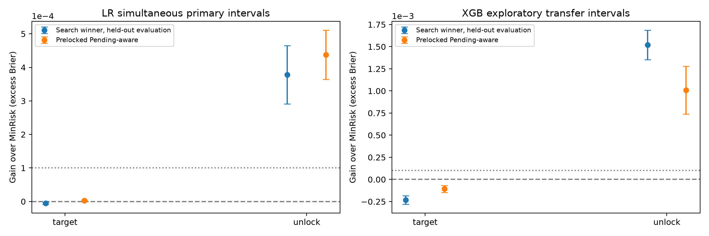
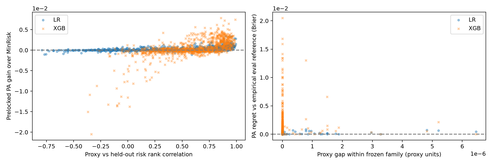

# M4: finite-family localization and transfer

延续[已完成的 M1–M3](../mechanisms_20261101/README.md)，本阶段按 2026-10-29 机制方案 V2 第10节完成有限家族独立确认，并按预登记空间门槛决定追加 MC 排序及迁移计算。

独立确认 **512 世界**；方法/结构迁移 **64 世界**；MC条件诊断 **6 世界**。每项训练后端、合法训练成员、保存预测与风险均经本地全量审计。

[完整中文报告](M4_report.zh.txt) · [估计对象与边界](M4_estimands_and_limits.zh.txt) · [验收记录](M4_ACCEPTANCE.json)

## 有限家族主要结果

| 方向 | LR对比 | 点估计 | 同时区间 | 登记判定 |
|---|---|---:|---|---|
| target | heldout_search_winner_gain | -0.000005211 | [-0.000008293, -0.000002129] | negative_direction_only |
| target | Pending_aware_gain | +0.000002192 | [-0.000000113, +0.000004496] | within_delta_band |
| unlock | heldout_search_winner_gain | +0.000378029 | [+0.000290697, +0.000465361] | meaningful_positive |
| unlock | Pending_aware_gain | +0.000437567 | [+0.000364123, +0.000511012] | meaningful_positive |

正值表示参照 MinRisk 的风险更高。主家族 LR 四项 alpha=.02；delta=.0001。独立生成世界是n，标签/MC重复另计。

## 复算

[下载完整 M4 证据包](M4_localization_and_transfer_20261101.zip)，解压后运行 `python verify_portable.py --examples`。无需 GPU 或重新训练；NumPy/Pandas/SciPy 依赖见包内 requirements。全部登记区间由公开逐标签风险复算，第一ID家族世界保留完整输入/预测样例。全量大型原始预测本地保存并公开相对文件哈希索引。

公开源代码与审计元数据已去除本机个人路径；冻结本地原件哈希与公开导出字节关系见 PUBLIC_REDACTION.json。

## 方法和结论范围

离线 search-winner 是使用合成真生成规律的诊断程序；采集器不接收真实未来标签或外层T。家族经验最优含选优偏差，未声称全可行域最优。代理求解差距与实际Brier分别按各自单位报告。

ParBaLS 是明确的 Laplace/cost/pending 适配，承接 [Hu 与 Mussmann 的官方实现](https://github.com/ADDAPT-ML/ParBaLS/tree/b3dcc7a76528c311a73d753e4385aca973ffac65)，未声称原 NUTS 全复现。MC 对比定位冻结模型中的模拟数量影响，不能据此保证模型正确或真实任务收益。

**M4 验收时 M5 尚未执行。当前进度见 [M5 完整结果](../mechanisms_m5_20261102/README.md)。** 旧768轨迹只作为开发与内部稳健性；尚未宣称新机构/合格成熟队列的真实外部确认或新 SOTA。
