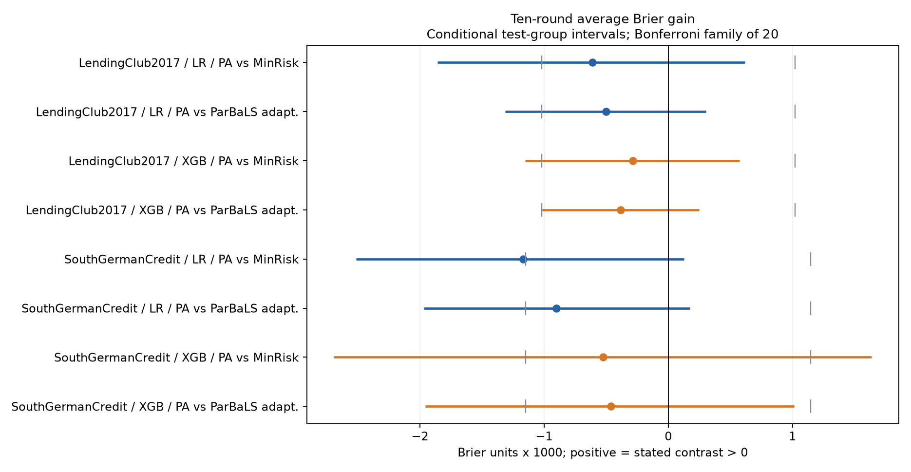
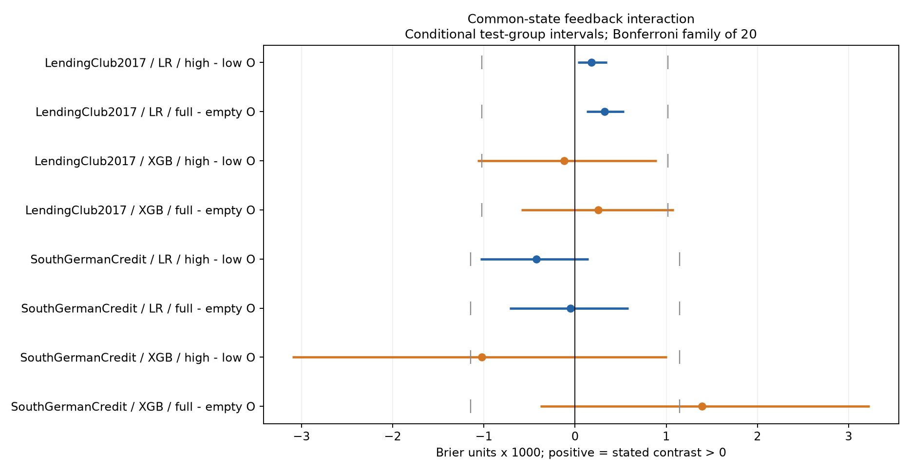
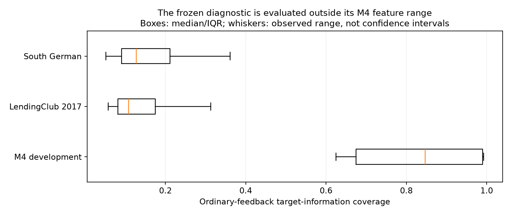

# M5 完整结果：真实任务机制与十轮流程

**2026-11-02：登记研究、全量预测审计与独立统计复算已完成。** 本页替代当前状态中的“8/40任务暂停”描述；[暂停检查点](../mechanisms_m5_checkpoint_20261102/README.md)作为历史记录保留。

[完整中文报告](M5_report.zh.txt) · [验收记录](M5_ACCEPTANCE.json) · [数据范围](dataset_profiles.json) · [固定分析计划](protocols/analysis_plan.json)

## 完成范围

- 两个来源任务：LendingClub 2017终态子样本3590条，South German Credit 1000条；共享封存测试集分别718人和200人。
- 40个回放任务、400条十轮轨迹、4000轮主记录、3600个共同状态分支。
- 7600个预测分支重新拟合并核对，最大预测重建误差为0；7600个标签释放承诺与最终锁集逐一绑定核验。
- 固定20项主要结果、每任务19999次测试实体组重采样；20项点估计、区间及Holm调整独立复算通过。
- 实验与审计完成不代表全部假设得到支持。没有确认实质正收益或通用迁移规律；不确定项保留，不追加到显著为止。

## 完整流程的主要结果

收益定义为参照方法Brier减去Pending-aware的Brier，正值更好。下表为固定20项家族内的近似同时区间，条件于已训练流程，只覆盖共同测试实体组的重采样波动。

| 数据 | 学习器 | 参照 | PA收益 | 同时区间 | 判定 |
|---|---|---|---:|---|---|
| LendingClub2017 | LR | MinRisk | -0.000611747 | [-0.001859574, +0.000614940] | 排除登记幅度的正收益 |
| LendingClub2017 | LR | ParBaLS适配版 | -0.000501343 | [-0.001311613, +0.000303676] | 排除登记幅度的正收益 |
| LendingClub2017 | XGB | MinRisk | -0.000284727 | [-0.001151369, +0.000572435] | 排除登记幅度的正收益 |
| LendingClub2017 | XGB | ParBaLS适配版 | -0.000384838 | [-0.001017990, +0.000248521] | 位于登记实质带内 |
| SouthGermanCredit | LR | MinRisk | -0.001166677 | [-0.002515336, +0.000124661] | 排除登记幅度的正收益 |
| SouthGermanCredit | LR | ParBaLS适配版 | -0.000900136 | [-0.001966952, +0.000171753] | 排除登记幅度的正收益 |
| SouthGermanCredit | XGB | MinRisk | -0.000526263 | [-0.002693067, +0.001638060] | 不确定 |
| SouthGermanCredit | XGB | ParBaLS适配版 | -0.000460919 | [-0.001954988, +0.001012565] | 排除登记幅度的正收益 |

八项点估计全部为负；七项排除了达到预设正收益门槛，德国XGBoost对MinRisk仍不确定。LendingClub的delta约0.001020237，德国约0.001146944。



## 支持到哪里

1. 普通反馈的可得性及方向在个别条件下改变相对收益，但本轮变化不足以支持完整十轮流程改善。LendingClub LR两个小正方向交互都处于登记实质带内。
2. M4冻结诊断规则在两个LR任务上未证明优于常数基准，在两个XGBoost任务上明显更差。全部评价状态处于M4覆盖指标范围之外；这是迁移边界线索，未识别唯一失败原因。
3. 额外标签的描述性平均收益与复杂选法超越MinRisk的确认结论分开报告；八项主要比较未建立复杂选法的实质优势。





## 额外标签的描述性观察

两个任务、两个学习器的均值中，MinRisk与PA都优于OrdinaryOnly。该比较未作为本轮主要家族的确认命题，不能事后升级为普遍收益结论。以下是十轮平均Brier，越低越好：

| 数据 | 学习器 | OrdinaryOnly | MinRisk | Pending-aware |
|---|---|---:|---:|---:|
| LendingClub2017 | LR | 0.179057 | 0.174391 | 0.175003 |
| LendingClub2017 | XGB | 0.181187 | 0.179787 | 0.180072 |
| SouthGermanCredit | LR | 0.209625 | 0.206136 | 0.207303 |
| SouthGermanCredit | XGB | 0.213534 | 0.209259 | 0.209785 |

## 独立复算

[下载完整结果与复算包](M5_results_and_reproduction_20261102.zip)，解压后在包目录运行：

```bash
python verify_portable.py
```

无需原始信用数据或GPU。全部20项聚合结果与区间可复算；最大规范统计重算误差为8.46e-11。原float32预测的等价表达式舍入差单独记录，统计门槛与原结果未更改。

完整训练源代码在包内保留供审阅；依赖原工作目录的全流程训练尚未在新机器验证，不声称本包已实现迁移路径下的一键全训练。

## 数据与结论边界

LendingClub为2017年Fully Paid/Charged Off终态子样本，不能证明整个队列成熟，也没有标签实际可获得的完整时间；South German为坏账过采样的小型历史修正基准，金额经过变换。已知标识/精确重复组隔离不等于完整借款人身份保证。
本轮是回顾性新任务/后续队列一致性检验；不识别真实拒贷反事实，不声称严格as-of在线效果或训练总体的不确定性覆盖。20个回放种子不作为20份独立数据。
ParBaLS为明确的Laplace/cost/pending适配版。M4已有正结果没有被用来替代M5的未支持结果。后续半合成桥接仅有研究草案，尚未执行。
公开目录只含聚合结果、来源哈希、协议、审阅源代码、审计元数据和旧合成诊断数据。第三方原始信用数据、申请人标识/特征/选集、个体预测与标签留在本地。公开导出映射见PUBLIC_REDACTION.json；完整映射文件位于ZIP根目录。

[M1–M3综合证据](../mechanisms_20261101/README.md) · [M4完成证据](../mechanisms_m4_20261101/README.md) · [当前状态](../M4_M5_CURRENT_STATUS_20261102.md)
