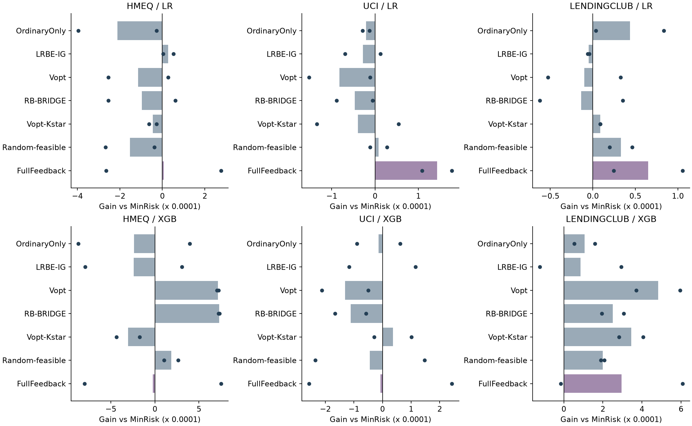
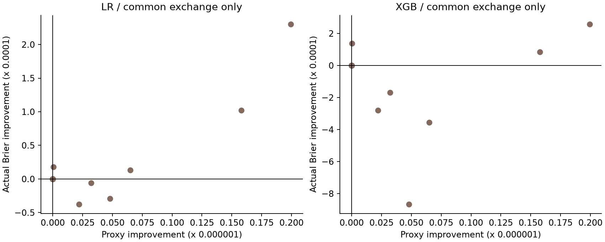
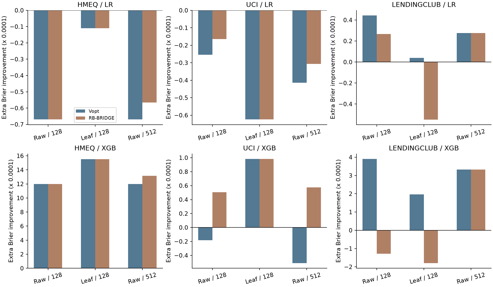
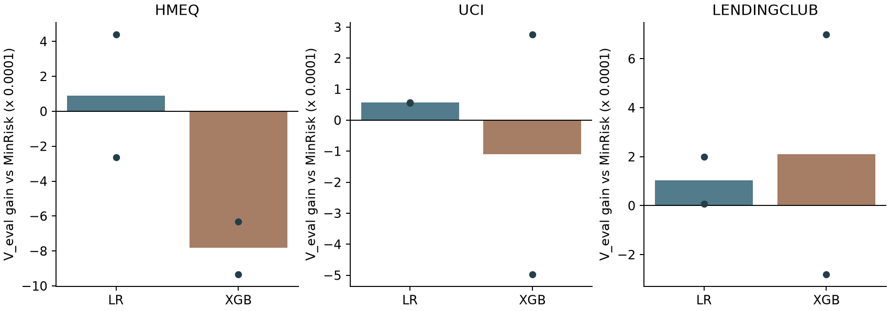

# LexiRiskLabel 下一阶段实验报告

2026 年 10 月 27 日

已按提供的下一阶段协议完成 E0、E1，并根据结果触发 E2b、E2c 和 E1b。当前最清楚的结果是：同一选集对逻辑回归和 XGBoost 的作用确实不同；真实信息代理中存在正互补性，但本轮双人构造没有贡献额外选集或预测收益。交换优化提高代理目标后，真实误差仍可能变差。冻结树叶表示也没有稳定解决这些问题。独立验证挑选的有限选集参照仍未形成稳定的 XGBoost 优势。目前没有可进入正式确认的唯一新候选。

## 本阶段实际运行了什么

基于提交 45a2d41d403ce0587d5434f564abb76ac7eaaf48，旧 84 条轨迹保持冻结。新 E1 只从 MinRisk 的 HMEQ/UCI/LendingClub、2201/2202、第 2/5/9 轮提取 18 个共同状态。它们属于 6 条轨迹、两个种子值，不能作为 18 个独立种子。

每个状态包含普通反馈基线、MinRisk、LRBE-IG、V-opt、BRIDGE、固定 K* V-opt、5 次固定随机可行抽签和全反馈诊断。每个选集原封不动交给 LR 和 XGBoost；没有为两个学习器分别挑样本。随机重复先在状态内取均值，再把同轨迹三个状态取均值，最后完整保留两种子的配对差。

E1 共 432 个名义拟合槽位，实际新拟合 386 次、缓存复用 46 次；72 次 IG 委员会拟合另记。E2b 144 个槽位全部复用 E1，新增拟合为 0。E2c 144 个槽位只新增 36 次学习器拟合，复用 108 次，另训练 6 个固定的小型叶表示模型。这些是单轮诊断拟合槽位，不是协议中暂缓的 720 条十轮确认轨迹。

E1b 针对另外的独立 V_search/V_eval 预测，6 个状态各生成 16 个不同可行选集，共拟合 192 个分支。此前缓存保存的是 T 预测，没有保存这些模型或 V 预测，因此该组需要拟合固定训练集后预测新的验证块；它们仍不增加独立数据簇。全部训练行按申请 ID 规范排序，所有分支共用同一排序约定。

所有 XGBoost 和叶表示模型实际训练后端均为 cuda:0；逻辑回归在 CPU 求解。没有静默 CPU 回退。没有新预算网格、调参、追加种子或结果驱动删任务。

## E0 审计

候选标签、普通 pending 标签和外层 T 标签分别翻转，8 种选择器及重新计算的 IG 分数不变。配置、代码、数据身份改变均被拒绝复用；未锁定选集时反馈服务拒绝释放 O/S 标签；重复采集被拒绝。相同干预与相同训练数据分别以 hash 去重和缓存，不作为重复证据。

采集输入只有 D 标签与 O/C/Q_ref 特征；T 特征和标签保留在独立 evaluator 中。预处理按冻结 D0 拟合，Q_ref 与 T、D、O、C 隔离。逐人误差、预测、原始 Gamma、采集记录和叶模型均留在 private 目录。

新 FutureProtocol 将未来批量 160、容量 80、风险上限 20、阈值 0.5 显式统一，并把 planning_horizon 和 actual_future_release 分开。审计证明 horizon=1 不会自动关闭环境中的未来反馈，关闭实际释放也不会偷改规划时域。它是后续 E4 的接口与审计准备，不代表旧 GATE 实验已经按新参数重做。

旧 CORR 的 60 个轮次已记录 pi=0 支持区域，其中 17 个候选轮次记录不可达；只保留正概率支持域上的设计校正恒等式，不宣称全域恢复。已有矩阵、穷举与校正恒等式继续通过，但这些不被当成学习效益证据。

## E1 同状态收益

下表为先按轨迹聚合后的两种子开发均值。gain_vs_ordinary 为 Brier(D+O) 减 Brier(D+O+S)；gain_vs_minrisk 为 MinRisk 分支 Brier 减该分支 Brier。正数表示改善。

| dataset | learner | selector | gain_vs_ordinary | gain_vs_minrisk |
| --- | --- | --- | --- | --- |
| hmeq | LR | FullFeedback | 0.0002174 | 0.0000062 |
| hmeq | XGB | FullFeedback | 0.0002139 | -0.0000228 |
| hmeq | LR | MinRisk | 0.0002112 | 0.0000000 |
| hmeq | XGB | MinRisk | 0.0002367 | 0.0000000 |
| hmeq | LR | RB-BRIDGE | 0.0001144 | -0.0000968 |
| hmeq | XGB | RB-BRIDGE | 0.0009659 | 0.0007292 |
| hmeq | LR | Vopt | 0.0000973 | -0.0001139 |
| hmeq | XGB | Vopt | 0.0009518 | 0.0007151 |
| hmeq | LR | Vopt-Kstar | 0.0001659 | -0.0000453 |
| hmeq | XGB | Vopt-Kstar | -0.0000683 | -0.0003051 |
| lendingclub | LR | FullFeedback | 0.0000214 | 0.0000651 |
| lendingclub | XGB | FullFeedback | 0.0001900 | 0.0002963 |
| lendingclub | LR | MinRisk | -0.0000437 | 0.0000000 |
| lendingclub | XGB | MinRisk | -0.0001063 | 0.0000000 |
| lendingclub | LR | RB-BRIDGE | -0.0000573 | -0.0000136 |
| lendingclub | XGB | RB-BRIDGE | 0.0001445 | 0.0002508 |
| lendingclub | LR | Vopt | -0.0000537 | -0.0000100 |
| lendingclub | XGB | Vopt | 0.0003768 | 0.0004832 |
| lendingclub | LR | Vopt-Kstar | -0.0000350 | 0.0000087 |
| lendingclub | XGB | Vopt-Kstar | 0.0002382 | 0.0003445 |
| uci | LR | FullFeedback | 0.0001636 | 0.0001430 |
| uci | XGB | FullFeedback | 0.0000066 | -0.0000072 |
| uci | LR | MinRisk | 0.0000206 | 0.0000000 |
| uci | XGB | MinRisk | 0.0000138 | 0.0000000 |
| uci | LR | RB-BRIDGE | -0.0000265 | -0.0000471 |
| uci | XGB | RB-BRIDGE | -0.0000979 | -0.0001117 |
| uci | LR | Vopt | -0.0000615 | -0.0000822 |
| uci | XGB | Vopt | -0.0001171 | -0.0001309 |
| uci | LR | Vopt-Kstar | -0.0000192 | -0.0000398 |
| uci | XGB | Vopt-Kstar | 0.0000498 | 0.0000361 |

HMEQ 和 LendingClub 的 XGBoost 分支中，V-opt/BRIDGE 相对 MinRisk 有开发性单步改善；LR 并未同步改善，UCI 的复杂自由基数方法仍偏弱。这个结果表明学习器与训练历史会改变结论，不能把上一轮完整十轮策略的排名直接搬来解释这一组共同状态分叉。

FullFeedback 使用 D+O+C，费用不受本轮预算限制，只是诊断。部分预算内选集胜过全反馈，因此全反馈不是本实验的统计或理论上界。反之，全反馈较差也不能排除某个预算内子集更好。

完整的每条轨迹均值与配对差在 e1_trajectory_paired_differences.csv；不为两个种子生成强显著性判断。外层旧测试已经用于开发，所有结果都按开发证据解释。

## E2b 正互补性与求解器的分离

在同一 H、G、风险成本和候选池上，检查全部当前可行双人对。Gamma 阈值为绝对 1e-12 加相对 1e-8 的联合增益尺度，保存原始数值与阈值。

去掉四格的重复审计后，一条单人构造路径上累计有 5529 次 visited pair 的正 Gamma，涉及全部 18 个状态；初始状态共有 12215 个可行候选对，其中 1581 个超过容差。visited pair 会随已选前缀重复评价，不能当成独立样本或独立证据条数。

四格为单人/不交换、单人/交换、双人/不交换、双人/交换。所有格共享候选池、几何、最佳单点保护、计算上限；启用交换时统一只做最多一次 1→1 可行交换，探查相同的 8 个移除候选。这与旧 BRIDGE 的混合交换规则分开记账。

结论是：18 个状态里，启用双人构造本身没有改变任何选集；在相同交换设置下，两种学习器的 Brier 差均严格为 0。7 个状态的选集因交换而改变，但这不是互补组构造的作用。所有格均未触及计算上限。存在正 Gamma 不等于某个双人单元的风险归一化联合价值足以胜过最佳单人，更不等于最终学习必然改善。

交换增加代理 F 后，LendingClub 的若干实际重训分支反而变差。当前证据反对把代理优化改善直接解释成预测收益；也不支持继续盲目增加 partners 或交换次数。

## E2c 表示与参考规模诊断

预先固定六个 dataset×seed 的第 5 轮状态，未挑选提升轮次。主对照是 raw/Q128 与 frozen-leaf/Q128；另以 raw/Q512 检查参考规模。没有同时引入新求解器或调参。

叶模型仅用当时 D 的标签训练，20 棵深度 2 树，实际形成 79–80 个叶特征。各方法共用冻结叶表示和同一 G、正则、预算。LR 在对应冻结表示上训练；完整 XGBoost 始终重新生长原始标准化特征上的树，同一方法跨学习器仍共享 selected_hash。没有把叶子 Fisher 当成全树重训的精确 Hessian。

| dataset | learner | condition | selector | gain_vs_minrisk |
| --- | --- | --- | --- | --- |
| hmeq | LR | leaf_ref128 | RB-BRIDGE | -0.0000110 |
| hmeq | XGB | leaf_ref128 | RB-BRIDGE | 0.0015508 |
| hmeq | LR | leaf_ref128 | Vopt | -0.0000110 |
| hmeq | XGB | leaf_ref128 | Vopt | 0.0015508 |
| hmeq | LR | raw_ref128 | RB-BRIDGE | -0.0000669 |
| hmeq | XGB | raw_ref128 | RB-BRIDGE | 0.0011973 |
| hmeq | LR | raw_ref128 | Vopt | -0.0000669 |
| hmeq | XGB | raw_ref128 | Vopt | 0.0011973 |
| hmeq | LR | raw_ref512 | RB-BRIDGE | -0.0000565 |
| hmeq | XGB | raw_ref512 | RB-BRIDGE | 0.0013149 |
| hmeq | LR | raw_ref512 | Vopt | -0.0000669 |
| hmeq | XGB | raw_ref512 | Vopt | 0.0011973 |
| lendingclub | LR | leaf_ref128 | RB-BRIDGE | -0.0000548 |
| lendingclub | XGB | leaf_ref128 | RB-BRIDGE | -0.0001793 |
| lendingclub | LR | leaf_ref128 | Vopt | 0.0000038 |
| lendingclub | XGB | leaf_ref128 | Vopt | 0.0001971 |
| lendingclub | LR | raw_ref128 | RB-BRIDGE | 0.0000268 |
| lendingclub | XGB | raw_ref128 | RB-BRIDGE | -0.0001287 |
| lendingclub | LR | raw_ref128 | Vopt | 0.0000443 |
| lendingclub | XGB | raw_ref128 | Vopt | 0.0003900 |
| lendingclub | LR | raw_ref512 | RB-BRIDGE | 0.0000276 |
| lendingclub | XGB | raw_ref512 | RB-BRIDGE | 0.0003322 |
| lendingclub | LR | raw_ref512 | Vopt | 0.0000276 |
| lendingclub | XGB | raw_ref512 | Vopt | 0.0003322 |
| uci | LR | leaf_ref128 | RB-BRIDGE | -0.0000624 |
| uci | XGB | leaf_ref128 | RB-BRIDGE | 0.0000981 |
| uci | LR | leaf_ref128 | Vopt | -0.0000624 |
| uci | XGB | leaf_ref128 | Vopt | 0.0000981 |
| uci | LR | raw_ref128 | RB-BRIDGE | -0.0000165 |
| uci | XGB | raw_ref128 | RB-BRIDGE | 0.0000506 |
| uci | LR | raw_ref128 | Vopt | -0.0000255 |
| uci | XGB | raw_ref128 | Vopt | -0.0000182 |
| uci | LR | raw_ref512 | RB-BRIDGE | -0.0000307 |
| uci | XGB | raw_ref512 | RB-BRIDGE | 0.0000574 |
| uci | LR | raw_ref512 | Vopt | -0.0000414 |
| uci | XGB | raw_ref512 | Vopt | -0.0000510 |

叶表示在 HMEQ 的 XGBoost 分支有改善，但在 LendingClub 等任务上没有一致收益；匹配叶逻辑头本身也未稳定胜过 MinRisk。把 Q_ref 从 128 加到 512，同样没有形成一致改善。这些结果支持继续研究价值估计与真实训练的关系，不能据此认定叶表示已经解决代理失配。

## E1b 独立验证的有限选集参照

E2b/E2c 之后，剩余收益空间仍难区分，因此按协议在全部六个固定第 5 轮状态执行 E1b。每状态先生成 16 个不同预算可行集合，来源为既有方法、随机可行及风险匹配交换。交换风险差预设为不超过 1% 的 B，失败时不放宽容差。相同集合只记一次，来源别名合并。全部集合先锁定，再释放对应 O/S 标签。

从此前只用作开发协变量的 20% 数据中，排除 Q_ref 后，将剩余部分按固定随机种子分成互不重叠的 V_search 和 V_eval；也与 D/O/C 和外层 T 隔离。训练参数不调，按 V_search 的 Brier 选取 16 个集合中的最佳，再只用 V_eval 报告该参照的效果。没有在外层 T 或 V_eval 上挑最优集合。

下表是两个开发种子的配对均值。它明确使用额外验证标签，只能作为有限集合离线诊断，不能放入可部署策略主排名，也不是全局最优或统计上界。

| dataset | learner | gain_V_eval_vs_minrisk | gain_V_eval_vs_ordinary |
| --- | --- | --- | --- |
| hmeq | LR | 0.0000881 | 0.0003760 |
| hmeq | XGB | -0.0007819 | 0.0003072 |
| lendingclub | LR | 0.0001032 | 0.0001751 |
| lendingclub | XGB | 0.0002096 | 0.0010011 |
| uci | LR | 0.0000566 | 0.0000368 |
| uci | XGB | -0.0001101 | -0.0002075 |

UCI 和 LendingClub 的 LR 参照相对 MinRisk 有正向小试信号，但 XGBoost 的验证优势未跨种子稳定保留；HMEQ 的 XGBoost 参照在两种子上都劣于 MinRisk。这说明旧 T 上的开发改善不能直接当成验证中可靠的收益。它也没有证明预算内不存在更好选集：候选家族仅有 16 个集合，V_search 选择本身有噪声，验证区间尚未做确认性推断。

## 阶段判断

支持：共同状态分叉有必要；选集对不同学习器的真实作用会变化；正 Gamma 可以存在，但当前逐步搜索没有将其变成额外干预；普通局部交换必须与成组构造分开解释。

反证或不支持：本轮数据不支持把 BRIDGE 的开发收益归因为互补双人构造；F 变大不保证真实 Brier 变好；单纯换冻结叶表示或扩大目标参考样本，尚未形成稳定修复。

仍不确定：预算内是否有当前有限方法未找到的高价值选集；这些状态的效果能否在独立验证块与新完整流程中保留；标签构成、模型容量和真实学习价值各自的边界。

继续路线：把 E1b 的验证差异作为后续约束，只允许围绕一个明确学习器设计最多一个价值估计候选。需要承认目前仍无法完全区分选集空间、有限候选家族与估计噪声；不能把外层 T 或 V_eval 上最好的事后选集当成新泛化算法。

停止或暂缓：不扩大 BRIDGE 的 partners/交换网格；CORR 仍保留冻结负结果，不追加 alpha 搜索；GATE 不扩大时域或算力。E2a 的完整 300 端点网格、E2d 数量交叉、完整内外层调参与 720 条十轮确认轨迹均未启动。目前没有可冻结为正式主比较的唯一新候选。

## 交付与复现

运行配置 protocol.json、原协议全文与新增代码位于项目 experiments/protocol_next。E1 源身份固定了配置、代码、数据、锚点档案与依赖版本；E2b/E2c 的 activation.json 另记录触发原因、源 hash、父身份和预设计算范围。

state_manifest.jsonl、selection_summary.jsonl、branch_outcomes.jsonl 使用状态和选集 hash 审计；全部逐人记录与预测误差在 private，不随公开汇总发布。final_verification.json 验证共享选集/训练 hash、预测重算、GPU 实际后端与叶表示可见性。运行 manifest 记录文件身份，不把缓存命中或重复抽签计为新独立数据。
