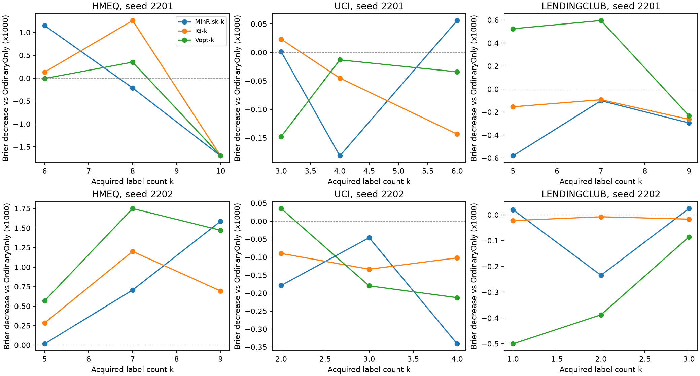

# E2d：数量与构成的固定状态诊断

结论：本轮没有支持“只要增加探索标签数量就能修复第一轮结果”的一致证据，也没有确认一种稳定优于 MinRisk 的标签构成规则。固定数量后，Vopt 的 XGB 平均 Brier 略有改善，但各数据集都只有 3/6 个状态—数量组合改善；局部近似同风险交换比较也随数据集、种子变化。暂不更换数据集、不扩大 BRIDGE 搜索、不按这次测试结果挑选最优 k。

## 范围与执行

严格使用协议 E2d，3 个原有数据集、2 个原有种子，只取第 5 轮的 6 个共同状态。每个状态比较 floor(0.6Kstar)、floor(0.8Kstar)、Kstar，去重后共 18 个状态—数量组合，另保留 OrdinaryOnly 基准。

| 数据集 | 种子 | Kstar | 实际 k |
| --- | --- | --- | --- |
| hmeq | 2201 | 10 | [6, 8, 10] |
| hmeq | 2202 | 9 | [5, 7, 9] |
| uci | 2201 | 6 | [3, 4, 6] |
| uci | 2202 | 4 | [2, 3, 4] |
| lendingclub | 2201 | 9 | [5, 7, 9] |
| lendingclub | 2202 | 3 | [1, 2, 3] |

MinRisk-k 取最小风险的 k 人；IG-k 在共同预算内以等式约束强制恰好 k 人，MILP 均达到最优；Vopt-k 使用原有条件几何、单位风险边际价值及剩余数量可行性约束，不启用交换。IG 复用同一状态已有的 D-only 委员会分数。所有选集均先锁定，再释放标签；LR 与 XGB 用同一选集。

共有 91 个方法动作槽、182 个学习器拟合槽，实际新增 126 次拟合、复用 56 次；不同训练干预共 88 个。这些都不是独立统计样本。XGB 实际后端为 CUDA，LR 使用 CPU。代码、原始输入、锚点和 E1 身份核验通过，保存预测重新计算的 Brier 一致。

## 同数量比较

下表增益 = MinRisk-k 的 Brier − 该方法 Brier，正数表示改善。先在每条种子轨迹内平均 3 个 k，再平均 2 条轨迹；改善次数仅作描述。完整风险、预算使用率、相对同数量最小风险集合的构成溢价保存在 resource_costs.csv。同数量不代表同风险。

XGBoost：

| 数据集 | 方法 | Brier 增益 | 改善次数 | 组合数 |
| --- | --- | --- | --- | --- |
| hmeq | IG-k | +0.00005423 | 3 | 6 |
| hmeq | Vopt-k | +0.00014798 | 3 | 6 |
| lendingclub | IG-k | +0.00010165 | 4 | 6 |
| lendingclub | Vopt-k | +0.00018021 | 3 | 6 |
| uci | IG-k | +0.00003323 | 4 | 6 |
| uci | Vopt-k | +0.00002296 | 3 | 6 |

逻辑回归：

| 数据集 | 方法 | Brier 增益 | 改善次数 | 组合数 |
| --- | --- | --- | --- | --- |
| hmeq | IG-k | -0.00000153 | 4 | 6 |
| hmeq | Vopt-k | +0.00006254 | 5 | 6 |
| lendingclub | IG-k | +0.00002204 | 6 | 6 |
| lendingclub | Vopt-k | +0.00003437 | 5 | 6 |
| uci | IG-k | -0.00002566 | 2 | 6 |
| uci | Vopt-k | -0.00002824 | 2 | 6 |

在 XGB 的 18 条“状态×方法”数量曲线中，从最低 k 增至 Kstar 后有 9 条改善，9 条变差；完整三个点单调改善的只有 2 条。因此不能把第一轮结果统一归因为探索标签太少。这里数量变化伴随具体选集和实际风险变化，仍不是纯粹数量的因果效应。

## 近似同风险的随机交换

在看到本轮终点前固定容差为每状态预算 B 的 1%。对 IG-k、Vopt-k 各自枚举同数量的一换一集合，仅保留预算可行且与目标选集实际风险差不超过 0.01B 的交换，使用固定种子均匀抽取一个。只做一次局部对照，不扩大为随机重复网格，不根据标签或测试结果选交换。

36 个目标中 31 个成功、5 个不可估计。下表仅对成功匹配的状态—数量组合取平均，缺失不插补；这是局部交换结果，不能推广为全空间随机策略的优劣。部分行只覆盖一个种子，不能与其他行直接比较总体大小。

下表增益 = 随机交换集合 Brier − 目标集合 Brier，正数表示目标构成较好（XGB）：

| 数据集 | 目标方法 | 相对交换增益 | 改善次数 | 匹配组合数 | 覆盖种子数 |
| --- | --- | --- | --- | --- | --- |
| hmeq | IG-k | -0.00017620 | 2 | 6 | 2 |
| hmeq | Vopt-k | -0.00018323 | 3 | 4 | 2 |
| lendingclub | IG-k | -0.00004144 | 3 | 6 | 2 |
| lendingclub | Vopt-k | +0.00048101 | 3 | 3 | 1 |
| uci | IG-k | +0.00000858 | 3 | 6 | 2 |
| uci | Vopt-k | -0.00001069 | 3 | 6 | 2 |

无法匹配的具体组合：

| 状态 | k | 目标方法 |
| --- | --- | --- |
| hmeq_seed2201_round5 | 6 | Vopt-k |
| hmeq_seed2202_round5 | 9 | Vopt-k |
| lendingclub_seed2202_round5 | 1 | Vopt-k |
| lendingclub_seed2202_round5 | 2 | Vopt-k |
| lendingclub_seed2202_round5 | 3 | Vopt-k |

LendingClub 的 Vopt 局部匹配只覆盖种子 2201，种子 2202 全部匹配失败。不能据此声称在 LendingClub 已确认构成优势。

## 对下一步的约束

这些结果收窄了原因：部分状态下标签构成确实改变了结果，但数量增加和代理价值更高都没有一致转化为 XGB 改善。数据规模可能限制可检测性，却不能作为全部失败的解释。

本阶段只完成 E2d，不启动 720 条确认轨迹、不更换数据集、不增大搭档或交换次数。当前不足以冻结一个新 BRIDGE 候选；保留旧负结果和本轮全部组合，后续若继续协议，应进入已规定的 CORR/GATE 小型机制诊断，不能把这轮测试集上最好的 k 包装成新的推荐策略。

每数据集只有两个开发种子；同一状态内各分支共享外部测试集，三个 k 也共享同一锚点，不能按 18 或 91 个独立样本计算显著性。本报告不提供确认性 p 值或宣称稳定胜出。个体 ID、标签、逐条预测和选集仅保存在本地 private/，交付压缩包只有代码与汇总证据。
