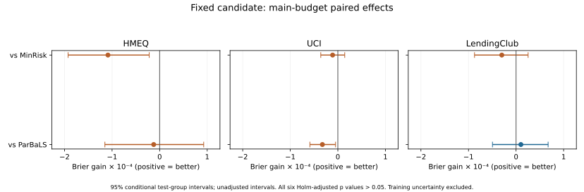

# LexiRiskLabel：按指定Markdown实验清单的完成报告

执行依据：用户提供的experiment_protocol_zh.md，SHA256为052b064834a804f613e016aee007cee79b4fb201205d4135c7d3517886d8c9e8。当前报告只将这份Markdown列为执行清单；旧DOCX追加实验保留为历史补充，不计入本清单的完成依据。

## 完成了什么

E0/E1/E1b/E2a—E2d/E3/E4以及唯一候选诊断均已完成。E2a现为十种子300终点完整网格。第9节完成360条主预算和360条补充预算的十轮轨迹，共720条；另按该节完成三任务配置轮换36条、后续2016队列12条，共768条完整轨迹。后两项未扩展补充预算或增加方法。

外层每次重新划分、拟合预处理、建立初始可见集、训练业务定价模型、构造独立参考、在D0内调参，再完整采集与重训。HMEQ/UCI采用重复分组五折，LendingClub采用注册月份前向窗口。现有7200轮可见历史、采集去重、预算与实际损失账本已重建核验；所有保存预测重新计分误差为0。第11节三种逐轮表各7200行；未记录的同状态边际基线或逐模型耗时保留为空，未从不同历史的普通轨迹伪造。

## 主结果

正数为参照Brier−候选Brier，负数表示候选更差。主预算0.1保持不变；下表的20个重放案例相互相关，不作为20个独立总体样本：

| dataset | comparison | mean_gain | relative_gain_percent | positive_replay_cases | negative_replay_cases | conditional_p_Holm |
| --- | --- | --- | --- | --- | --- | --- |
| hmeq | FantasyCandidate_vs_MinRisk | -0.00010867 | -0.13154219 | 7 | 13 | +0.08995502 |
| hmeq | FantasyCandidate_vs_ParBaLS | -0.00001249 | -0.01510027 | 10 | 10 | +1.00000000 |
| lendingclub | FantasyCandidate_vs_MinRisk | -0.00002998 | -0.01949946 | 7 | 11 | +1.00000000 |
| lendingclub | FantasyCandidate_vs_ParBaLS | +0.00001015 | +0.00659805 | 9 | 10 | +1.00000000 |
| uci | FantasyCandidate_vs_MinRisk | -0.00001099 | -0.00814143 | 9 | 11 | +1.00000000 |
| uci | FantasyCandidate_vs_ParBaLS | -0.00003252 | -0.02408707 | 5 | 15 | +0.09995002 |

候选相对MinRisk的三个任务平均收益全部为负；相对近邻只有LendingClub均值微正。条件重采样给出的六个Holm调整p均大于0.05；CV重叠训练造成的依赖没有通过重训重采样覆盖，因此这些p与区间只作为固定预测集合的条件敏感性，不能当作整个流程已校准的确认检验。主实验描述结果也未形成跨任务稳定优势。没有在结果出来后更换主预算、模型网格、伪标签世界或新候选。

候选同时通常少买标签、少花探索风险，不能把预测排序简单当作完整经济排序；风险、数量和损失逐任务单列，不跨货币单位相加。0.5%研究阈值下，模型条件区间均落入等效带，但这些区间只条件于本批已训练模型，既不是整个训练过程的等效证明，也不是利润结论。区间低于零和落入等效带可以同时成立，完整布尔判据另列，不以互斥标签隐藏重叠。

## 迁移与后续队列

三任务内部迁移：

| dataset | reference | ALC_gain | final_gain | positive_streams | negative_streams | risk_difference |
| --- | --- | --- | --- | --- | --- | --- |
| hmeq | MinRisk | +0.00017845 | +0.00050429 | 2 | 0 | -11318.20900440 |
| hmeq | OrdinaryOnly | +0.00069470 | +0.00125056 | 2 | 0 | +276884.05209482 |
| hmeq | ParBaLS | +0.00008341 | +0.00029196 | 2 | 0 | -21801.27469897 |
| lendingclub | MinRisk | -0.00011866 | -0.00001923 | 0 | 2 | -17439.52992857 |
| lendingclub | OrdinaryOnly | -0.00017862 | -0.00012695 | 0 | 1 | +24507.42423311 |
| lendingclub | ParBaLS | -0.00002117 | -0.00020248 | 1 | 1 | -23148.50177988 |
| uci | MinRisk | +0.00002107 | +0.00004094 | 2 | 0 | -9.12933084 |
| uci | OrdinaryOnly | +0.00005804 | +0.00000709 | 1 | 1 | +37.26389161 |
| uci | ParBaLS | +0.00000779 | +0.00008037 | 1 | 1 | -9.96641141 |

2016后续队列：

| dataset | reference | ALC_gain | final_gain | positive_streams | negative_streams | risk_difference |
| --- | --- | --- | --- | --- | --- | --- |
| lendingclub | MinRisk | +0.00009103 | -0.00000107 | 2 | 0 | -31255.32507822 |
| lendingclub | OrdinaryOnly | +0.00001828 | -0.00008601 | 2 | 0 | +65363.89836967 |
| lendingclub | ParBaLS | +0.00003876 | -0.00002877 | 1 | 1 | -40131.26909211 |

迁移中HMEQ、UCI相对MinRisk出现正均值，LendingClub负；这是两个重放流的内部稳健性，不推翻主实验。2016固定合格队列9168条只用于评价，候选相对MinRisk的ALC收益约+0.00009103，两流均正；相对近邻约+0.00003876但只有一流正，终轮指标也并未一致胜出。正结果完整保留，不能挑它替代主要结果。

只有最终贷款状态、没有结果实际可得时点，因此2016检查按清单允许的即时标签回顾性假设报告，不声称严格as-of在线成熟标签验证、机构现场因果效果或真实拒绝人的反事实。贷款ID/精确重复特征分组也不等于拥有真实跨贷款借款人关联。

## 清单逐项完成情况

| 清单章节 | 要求 | 状态 | 证据与范围 |
| --- | --- | --- | --- |
| 1 | 唯一主问题 | 完成 | 所有主要效果以相同协议下相对MinRisk/近邻的真实Brier和风险报告 |
| 2 | 信息边界 | 完成 | D/O/C/R/T分离；先锁定再释放；跨期只作允许的回顾性假设 |
| 3/E0 | 实现与协议审计 | 完成 | 原分标签扰动、身份拒绝及新六方法定点扰动全部通过 |
| 4/E1 | 共同状态与学习器分叉 | 完成 | 18状态，432拟合槽；193不同干预，386实际模型；不把轮次当独立种子 |
| 5/E1b | 有限可行选集诊断 | 完成 | 6固定状态×16不同集合；Vsearch选择、Veval评价，额外研究标签单列 |
| 6/E2a | 精确正控制 | 完成 | 十种子、300终点；保留原90端点，逐池穷举；代理与LR收益分开 |
| 6/E2b | 成对搜索与交换拆分 | 完成 | 18状态四格，保存全部Gamma；不把交换效果归给成对构造 |
| 6/E2c | 表示匹配与参考规模 | 完成 | D-only冻结20棵深度2叶表示；Q128/512单列 |
| 6/E2d | 数量与构成 | 完成 | 18去重数量状态；31风险匹配成功，5不可估计，未放宽容差 |
| 7/E3 | 校正标签使用消融 | 完成并按门槛关闭主线 | 固定S/pi/g/回归器，含插件和两种收缩；完整piij方差核验 |
| 8/E4 | GATE关键配对 | 完成并按门槛停止扩展 | 规划/环境时序统一，真假释放及审批控制、独立世界和真生成器核验 |
| 9 | 完整采集流程内部评估 | 完成 | 60注册外层/重放单元，720条十轮轨迹，D0内层调参和月度前向划分 |
| 9/迁移 | 三任务轮换 | 完成 | 另外两任务固定配置，目标不调参；36条主预算轨迹，称内部迁移 |
| 9/时间队列 | 后续年份检查 | 按数据条件完成回顾性版本 | 2016预定义9168条目标记录仅评估，12轨迹；无标签可得时点，不称严格在线 |
| 10 | 指标与统计 | 按可支持范围完成 | 主预算固定；绝对/相对效果、delta敏感性、模型条件重采样与Holm；未估计完整训练不确定性 |
| 11 | 输出和证据 | 完成 | 确认表768轨迹；主实验状态/选集/结果各7200轮，原始选集/预测留本地 |
| 12 | 最多一个候选修改 | 完成 | 叶表示和唯一幻想候选已诊断；候选开发失败，固定保留作比较，不称胜出 |
| 13 | 支持/否定/不确定和停止决定 | 完成 | 无稳定新候选优势，不继续扩大CORR/GATE或新目标；正负结果全部保留 |

## 结论与交付

清单中可执行的实验及核验已完成。当前证据不支持把唯一新候选描述为稳定优于MinRisk的算法；开发失败和正式比较负结果均保留。E3/E4按原门槛停止扩展，不添加CVaR、公平性或生存模型。候选“胜出”不是被人为制造的完成条件。

完整训练抽样不确定性、标签真实成熟时点、借款人跨贷款关联与真实拒绝标签不由这些数据识别，未假称完成这类不具数据条件的推断。必要代码、冻结配置、报告、汇总和核验整理为独立审阅材料；完整第三方输入、选集、标签与逐样本预测保留本地。
