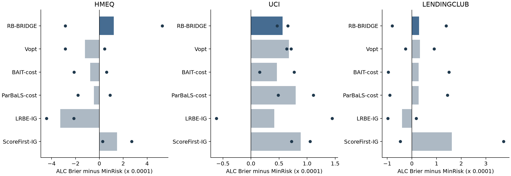
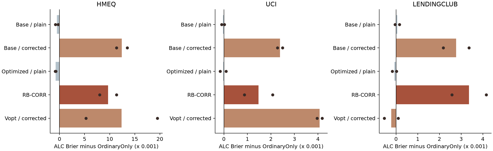
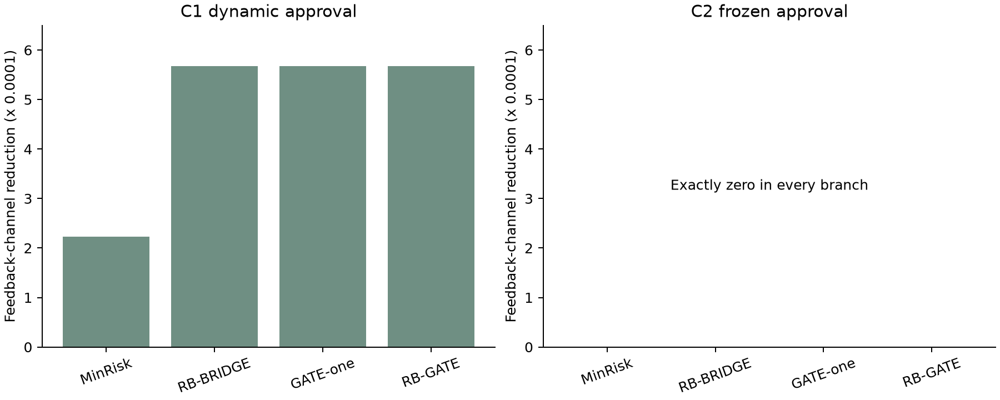

# LexiRiskLabel 小规模重做实验结果

2026 年 10 月 26 日

发布范围：本页及 GitHub 中保留代码、汇总结果和逐轮统计。含样本 ID、真实标签、逐样本预测、采集概率与伪目标的文件保留在完整本地档案，不随本次 GitHub 提交发布。发布的 verification.json 是对完整本地运行的验证摘要。

三种新方法均已实现并实际运行。当前开发结果没有支持把其中任何一种写成稳定优于强基线的新算法。RB-BRIDGE 在三份真实数据上平均未胜过 MinRisk；RB-CORR 的残差校正在本轮真实任务中增大 Brier；RB-GATE 的小型闭环试验没有显示其前瞻机制超越短视选择的稳定优势。全部正负结果均保留。

## 执行范围

按“论文改进建议”聊天的三条新算法路线执行，并完整读取补充的《LexiRiskLabel 研究重构与实验方案》。采用其中共同风险账本、普通反馈基线、独立目标参考、隐藏标签隔离、配置身份、完整成本及预测留存要求。

真实数据固定 rho=0.1，每个数据两个预定开发种子 2201、2202，十轮；分类器比较 48 条轨迹，平方损失交叉实验 36 条轨迹，共 84 条、840 个逐轮记录。十轮记录不作为十个独立重复。

六类机制环境 A1/A2、B1/B2、C1/C2 各用 2101–2103 三个开发种子，共 132 个方法终点；另在两个代表状态完成文档要求的条件化×批更新及数量下限诊断。它们属于实际重训分支，并非新增一批无关基准测试。

本轮没有启动聊天和文档举例的上千条正式轨迹、14×30 条件确认、额外大预算网格或 CVaR、公平性、延迟模块。RB-GATE 依聊天要求先限于小型闭环环境。当前结论是开发筛查，不能作为确认、显著性或投稿等级结论。

## RB-BRIDGE 与真实分类器比较

下表为十轮平均 Brier 的两种子均值，越低越好。所有方法共享固定业务审批、候选、数值预算、初始数据、目标参考及特征表示。

| dataset | OrdinaryOnly | MinRisk | LRBE-IG | Vopt | BAIT-cost | ParBaLS-cost | RB-BRIDGE |
| --- | --- | --- | --- | --- | --- | --- | --- |
| hmeq | 0.0822595 | 0.0812654 | 0.0809372 | 0.0811449 | 0.0811893 | 0.0812205 | 0.0813863 |
| lendingclub | 0.1458951 | 0.1457933 | 0.1457537 | 0.1458258 | 0.1458207 | 0.1458208 | 0.1458228 |
| uci | 0.1324941 | 0.1324025 | 0.1324440 | 0.1324702 | 0.1324487 | 0.1324824 | 0.1324587 |

RB-BRIDGE 减去 MinRisk 的配对差如下。正数表示 RB-BRIDGE 更差；“胜/负”仅表示这两个开发种子的方向。

| dataset | mean_delta_brier | seed_wins | seed_losses |
| --- | --- | --- | --- |
| hmeq | 0.0001209 | 1 | 1 |
| uci | 0.0000562 | 0 | 2 |
| lendingclub | 0.0000295 | 1 | 1 |

HMEQ 中 RB-BRIDGE 优于普通反馈基线，但没有超过 MinRisk 和 LRBE-IG；UCI 与 LendingClub 的差异也很小。可以确认代码改变了选样，不能据此确认新的互补组搜索具有实际优势。

## RB-CORR 的采集与训练交叉实验

所有分支均使用相同平方损失 XGBRegressor，输出限制到 [0,1]；本表不与上表的分类器混排。同一采集方式的普通训练与校正训练实际获得相同选集、相同采集概率，因而可以直接观察校正的影响。

| dataset | OrdinaryOnly | CORR-base-plain | CORR-base-corrected | CORR-opt-plain | RB-CORR | CORR-vopt-corrected |
| --- | --- | --- | --- | --- | --- | --- |
| hmeq | 0.0815859 | 0.0810500 | 0.0940094 | 0.0807912 | 0.0912583 | 0.0939749 |
| lendingclub | 0.1463142 | 0.1463707 | 0.1490820 | 0.1462366 | 0.1496806 | 0.1460937 |
| uci | 0.1324365 | 0.1323992 | 0.1348232 | 0.1324052 | 0.1339098 | 0.1365090 |

本轮完整 RB-CORR 在三份数据上均比对应的优化采集普通训练更差，也比普通反馈基线更差。数学上的固定函数风险估计无偏，未转化为训练后泛化改善。日志保存了精确边际概率、混合组成、历史伪目标、最大权重与有效样本量，没有通过截断权重隐藏方差代价。

这支持暂不把该校正版本直接用于论文主结果，不能仅凭无偏恒等式宣称学习收益。局部影响量采用平方损失线性头的曲率；迁移到树回归器仍属于代理，不能解释为精确树模型影响函数。

## 六类机制与 RB-GATE

- A1：普通反馈未覆盖干扰方向。探索相对 OrdinaryOnly 有明显改善，但 MinRisk 的平均 excess Brier 更低，结构化配对未形成优势。
- A2：保持普通反馈数量不变，改为覆盖干扰方向。OrdinaryOnly 自身的误差明显下降，付费探索的额外空间收缩；这支持覆盖方向会影响探索价值，但尚不证明 BRIDGE 搜索更好。
- B1：非线性概率与线性平方损失学习器错设。完整 CORR 未稳定胜过其不校正对照。
- B2：有界线性概率与线性平方损失学习器匹配。仍未出现校正必然有效的规律，保留其方差代价。
- C1：允许后续审批改变。RB-GATE 的平均 excess Brier 约为 0.0016799，RB-BRIDGE 约为 0.0014755。当前前瞻没有超过更简单的 BRIDGE。
- C2：冻结下一轮审批。每个分支的反馈渠道价值均严格为零，负控制成立。冻结审批后仍可能存在标签的直接价值，不能把它误称为渠道价值。

GATE 使用同一候选批次族、共同随机数和一致的潜在参数世界，16 个世界选择、另 8 个世界核验；未来申请特征从已经观察到的历史重采样。实际未来标签只在采集决定锁定后释放。普通与探索风险分别记账，未来普通审批受共同容量和预测风险额度约束。

## 文档中的组件与数量诊断

两个代表状态完成了有/无普通反馈条件化、有/无批内更新的四格对照，以及固定 K* 版本。它们保存在 focused_rows.csv，未扩展成额外的全因子大网格。

同一状态、同一预算、同一 IG 代理扫描 epsilon={0,0.05,0.10,0.20,1}。这两个状态的 K*=8，前三个 epsilon 因取整具有相同数量下限；即使放松至 0 或 7，求解器仍选择相同八人集合。因此这次小试未显示数量放松带来收益；没有把参数不同但选集相同伪装成不同发现。此处 IG 为机制模型的 Laplace 后验信息增益，不是信用数据上旧委员会 IG 的正式数量扫描。

## 正确性与原始证据核验

二维反例得到互补对价值 0.6666667，逐点贪心得到 0.0099990；普通方向信息增加到 b=9999 时互补性归零。秩二联合增益与直接求解的最大误差约 1.5e-15。12 人小候选池穷举中，该状态的 V-opt 和 BRIDGE 都达到代理最优；这只描述该小池，不是全局算法保证。

CORR 对有限采集分布逐项求和，风险估计期望误差约 5.6e-17。这个检查没有用几千次随机抽样制造更多“实验”。

对最终 84 个 episode 的 840 条逐轮记录，核验了实际 GPU 训练 device 与 updater、预算、选集子集、无重复、测试隔离、共同 O/C/成本/预算、有限混合概率及保存预测重算 Brier；预测预算违约为 0。改变隐藏普通、候选和测试标签的边界检查没有改变三种选择器输出。配置阈值改为 0.51 的伪续跑被明确拒绝，没有混入旧结果。

宿主机 RTX 5060 8GB 已通过真实训练验证；逐轮实际 device 为 cuda:0。逻辑代理与矩阵/背包优化在 CPU 上执行。NumPy 输入预测使用 DMatrix 路径，训练后端与输入位置分别记录，没有把预测警告误报为训练回退。

## 数据与解释边界

新获取 HMEQ 5,960 行、UCI 30,000 行、LendingClub 成熟队列 16,566 行（3,321 正类）。来源分别为 SAS 官方 GitHub、UCI 官方下载和仓库记载的 LendingClub 2014/2015 样本。每份新文件均有来源与 SHA-256，但没有与旧登记文件达成字节一致，因此新实验独立记录，未调用覆盖旧数据的强制选项。

LendingClub 采用预先列明的 21 个紧凑字段，排除 last_fico 等更新结果字段；HMEQ 排除暴露 LOAN 作为预测特征。该 schema、依赖版本、审批协议和划分不同于旧论文，不能把本轮差值直接拼到旧稿的均值或显著性表里。

两种子真实结果和三种子机制结果只够做开发判断。没有按结果追加种子、删任务或改成另一套获胜指标。BAIT/ParBaLS 为公开原理与作者代码结构上的透明成本适配；ParBaLS 使用 4 条幻想、32 个后验样本，不能宣称直接复现作者默认配置，也不能据此宣称战胜原版 SOTA。通用双人对照匹配初始候选对数，实际墙钟与后续可行组合数仍有差异。

## 当前决定

保留 MinRisk 与原 IG 作为有效强基线。RB-BRIDGE 目前只验证了机制起点；RB-CORR 的精确概率与校正实现可复用，但当前训练版本的真实负结果必须保留；RB-GATE 暂停在小型闭环开发结论，不投入大规模确认。

若继续研究，应针对本轮已经暴露的代理失配、校正方差和前瞻收益不足分别改方法，再冻结一个新版本。当前证据不支持把三个名字包装成已经成立的强创新算法。

## 复现入口

项目代码在 LexiRiskLabel/experiments/research_v2，最终原始目录为 results/research_v2/final_real、final_mechanisms 和 focused；其他原型目录不纳入汇总。完整本地轨迹包含 identity.json、十轮选样日志、trajectory.csv、test_predictions.npz，校正分支额外保存历史概率与伪目标；GitHub 只发布其中配置、逐轮汇总和完成记录。

本次依赖锁定、GPU 证据、来源对照、完整种子结果、配对描述差异和运行日志一并交付。运行命令在复现脚本中，已有结果的配置、源代码或数据身份不一致时拒绝续跑。

参考：[BAIT 作者论文](https://proceedings.neurips.cc/paper/2021/file/4afe044911ed2c247005912512ace23b-Paper.pdf)，[ParBaLS 作者实现](https://github.com/ADDAPT-ML/ParBaLS)，[SAS HMEQ](https://github.com/sassoftware/sas-viya-dmml-pipelines/blob/master/data/hmeq.csv)，[UCI](https://archive.ics.uci.edu/dataset/350/default+of+credit+card+clients)，[LendingClub 样本来源](https://bigblue.depaul.edu/jlee141/econdata/LendingClub_LoanData/)。
